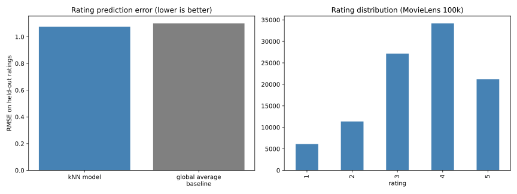

# Movie Recommender (MovieLens 100k)

Practice project built with AI assistance on a public dataset. It recommends movies
using item-item collaborative filtering: movies are similar if users
rated them similarly. Includes a Streamlit web app with similar-movie
lookup and per-user top-10 recommendations.

## Dataset

MovieLens 100k (100,000 ratings from 943 users on 1,682 movies, collected
1997-1998 by GroupLens). Downloaded from GroupLens automatically on first run if missing (and included in the offline copy).

## Project structure

- `train.py` - builds the user x movie matrix, fits item-item kNN with
  cosine distance, evaluates held-out rating RMSE against a
  global-average baseline, prints a similar-movies example, plots.
- `app.py` - Streamlit app: similar movies for any title, top-10
  recommendations for any user id (1-943).
- `results.svg` - RMSE comparison and rating distribution.
- `u.data`, `u.item` - the dataset.

## How to run

```bash
pip install -r requirements.txt
python train.py        # evaluation + example + plots
streamlit run app.py   # web app on http://localhost:8501
```

## Results

Rating prediction on 3,000 held-out ratings (lower RMSE is better):

| Method                  | RMSE  |
|-------------------------|-------|
| Item-item kNN (k=20)    | 1.075 |
| Global-average baseline | 1.100 |

Example - movies most similar to Star Wars (1977): Return of the Jedi,
Mystery Science Theater 3000, Hunt for Red October, Young Guns, ...



## Honest notes

- Practice project. A simple kNN on raw ratings only beats the
  global-average baseline slightly (1.075 vs 1.100 RMSE) - real
  recommenders use matrix factorization or deep models and do much
  better. This is the understandable baseline version.
- The dataset is from 1997-1998, so it only knows movies up to 1998.
